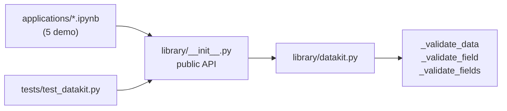

<div align="center">

# DataKit — Fungsio Function

**Pustaka pemrosesan data fungsional untuk `list[dict]` — murni, aman, tanpa dependensi eksternal.**

[](https://www.python.org/)
[](tests/test_datakit.py)
[](applications/)
[](LICENSE)
[](library/datakit.py)

Tugas 2 — Pemrograman Fungsional · Semester 5

</div>

---

## Daftar Isi

- [Tentang Proyek](#tentang-proyek)
- [Fitur Utama](#fitur-utama)
- [Struktur Proyek](#struktur-proyek)
- [Instalasi](#instalasi)
- [Mulai Cepat](#mulai-cepat)
- [Referensi API](#referensi-api)
- [Kontrak Validasi & Error](#kontrak-validasi--error)
- [Aplikasi Demo](#aplikasi-demo)
- [Pengujian](#pengujian)
- [Prinsip Desain](#prinsip-desain)
- [Batasan](#batasan)
- [Kontribusi](#kontribusi)
- [Lisensi](#lisensi)

---

## Tentang Proyek

**DataKit** adalah pustaka kecil yang mengemas lima operasi data yang paling sering
ditulis ulang di setiap program berbasis daftar dictionary — pencarian, penyaringan,
pengurutan, pengelompokan, dan statistik — menjadi fungsi murni (*pure functions*)
yang dapat dipakai berulang.

Semua bentuk data mengikuti satu kontrak tunggal:

```python
records = [
    {"id": 1, "name": "Laptop ASUS", "category": "Electronics", "stock": 10, "price": 8500000},
    {"id": 2, "name": "Mouse Logitech", "category": "Accessories", "stock": 25, "price": 150000},
    {"id": 3, "name": "Keyboard Mechanical", "category": "Accessories", "stock": 8, "price": 750000},
]
```

- **Input & output** berupa `list` berisi `dict`.
- **Tidak ada mutasi**: data asli tidak pernah diubah; setiap fungsi mengembalikan
  struktur baru.
- **Tanpa dependensi runtime**: hanya `math` dari standard library.

Lima fungsi tersebut kemudian dipakai ulang oleh **lima aplikasi notebook** dengan
domain berbeda (keuangan, inventaris, perpustakaan, nilai mahasiswa, registrasi event)
— membuktikan bahwa satu pustaka kecil bisa melayani banyak kasus tanpa duplikasi logika.

---

## Fitur Utama

| Fungsi | Kegunaan | Kompleksitas |
| :--- | :--- | :---: |
| `search_data()` | Pencarian substring multi-field, *case-insensitive* | $O(n \cdot f)$ |
| `filter_data()` | Penyaringan berdasarkan kesamaan nilai field | $O(n)$ |
| `sort_data()` | Pengurutan asc/desc dengan validasi tipe | $O(n \log n)$ |
| `group_data()` | Pengelompokan berdasarkan nilai field | $O(n)$ |
| `calculate_stats()` | Ringkasan statistik field numerik | $O(n)$ |

Karakteristik yang berlaku untuk semuanya:

- **Fail fast** — argumen tidak valid langsung melempar `TypeError` / `ValueError`
  dengan pesan spesifik, bukan `KeyError` yang membingungkan.
- **Toleran terhadap data kotor** — `None` dan field yang hilang dilewati pada
  operasi pencarian/filter/statistik.
- **Deterministik** — hasil hanya bergantung pada input; tidak ada state global.
- **Immutable** — dijamin oleh test `test_original_data_unchanged`.

---

## Struktur Proyek

```text
fungsio-function/
├── library/
│   ├── __init__.py          # Public API — re-export 5 fungsi
│   └── datakit.py           # Implementasi + validasi internal (293 baris)
├── tests/
│   └── test_datakit.py      # 22 test pytest (256 baris)
├── applications/            # Demo interaktif berbasis notebook
│   ├── finance-manager.ipynb
│   ├── inventory-managment.ipynb
│   ├── library-management.ipynb
│   ├── student-grade-manager.ipynb
│   └── event-registration-manager.ipynb
├── .vscode/settings.json    # Konfigurasi interpreter, pytest, import path
├── requirements.txt         # pytest>=8.0, ipykernel>=6.0
├── LICENSE                  # MIT
└── README.md
```

Alur ketergantungan:



`applications/` hanya bergantung pada nama publik di `library/`, bukan pada modul
internalnya. Detail validasi (`_validate_*`) bersifat privat dan tidak diekspor.

---

## Instalasi

```bash
git clone https://github.com/Machobotak/fungsio-function.git
cd fungsio-function

python -m venv .venv
# Windows
.venv\Scripts\activate
# macOS / Linux
source .venv/bin/activate

pip install -r requirements.txt
```

Interpreter yang dipakai untuk pengembangan: **Python 3.10.11**.

Pustaka sendiri tidak membutuhkan paket pip apa pun — `requirements.txt` hanya
berisi kebutuhan *tooling* (`pytest`, `ipykernel`).

---

## Mulai Cepat

```python
from library import (
    search_data,
    filter_data,
    sort_data,
    group_data,
    calculate_stats,
)

data = [
    {"id": 1, "name": "Laptop ASUS", "category": "Electronics", "stock": 10, "price": 8500000},
    {"id": 2, "name": "Mouse Logitech", "category": "Accessories", "stock": 25, "price": 150000},
    {"id": 3, "name": "Keyboard Mechanical", "category": "Accessories", "stock": 8, "price": 750000},
    {"id": 4, "name": "Monitor LG", "category": "Electronics", "stock": 5, "price": 3200000},
]

print(search_data(data, "logi", ["name"]))
print([p["name"] for p in filter_data(data, "category", "Accessories")])
print([p["price"] for p in sort_data(data, "price", reverse=True)])
print({k: len(v) for k, v in group_data(data, "category").items()})
print(calculate_stats(data, "price"))
```

Output aktual:

```text
[{'id': 2, 'name': 'Mouse Logitech', 'category': 'Accessories', 'stock': 25, 'price': 150000}]
['Mouse Logitech', 'Keyboard Mechanical']
[8500000, 3200000, 750000, 150000]
{'Electronics': 2, 'Accessories': 2}
{'count': 4, 'total': 12600000, 'average': 3150000.0, 'minimum': 150000, 'maximum': 8500000}
```

---

## Referensi API

Semua fungsi tersedia langsung dari paket:

```python
from library import search_data, filter_data, sort_data, group_data, calculate_stats
```

### 1 · `search_data(data, keyword, fields)`

Mencari data yang memiliki *keyword* pada salah satu field yang diperiksa.

| Parameter | Tipe | Keterangan |
| :--- | :--- | :--- |
| `data` | `list[dict]` | Kumpulan data |
| `keyword` | `str` | Kata kunci, tidak boleh kosong/whitespace |
| `fields` | `list` / `tuple` | Field yang diperiksa, minimal satu |

**Return:** `list[dict]` — item yang cocok (bisa kosong).

**Perilaku:**

- Perbandingan *case-insensitive* memakai `str.casefold()`.
- Pencocokan bersifat **substring**, bukan exact match.
- Nilai non-string dikonversi dengan `str()` sebelum dibandingkan.
- Field yang tidak ada pada item, atau bernilai `None`, dilewati.
- `keyword` kosong → `ValueError`; `fields` kosong → `ValueError`.

```python
>>> search_data(data, "laptop", ["name", "category"])
[{'id': 1, 'name': 'Laptop ASUS', 'category': 'Electronics', 'stock': 10, 'price': 8500000}]
>>> search_data(data, "  ", ["name"])
ValueError: keyword tidak boleh kosong.
```

---

### 2 · `filter_data(data, field, value)`

Menyaring data berdasarkan kesamaan nilai (`==`) pada satu field.

| Parameter | Tipe | Keterangan |
| :--- | :--- | :--- |
| `data` | `list[dict]` | Kumpulan data |
| `field` | `str` | Atribut yang dibandingkan |
| `value` | `Any` | Nilai pembanding |

**Return:** `list[dict]` — item dengan `item[field] == value`.

**Perilaku:**

- Tidak ada koersi tipe: `"10"` tidak sama dengan `10`.
- Item tanpa field tersebut dilewati (tidak melempar `KeyError`).
- Field yang tidak ada di seluruh data menghasilkan list kosong, bukan error.

```python
>>> [p["name"] for p in filter_data(data, "category", "Accessories")]
['Mouse Logitech', 'Keyboard Mechanical']
```

---

### 3 · `sort_data(data, field, reverse=False)`

Mengurutkan data berdasarkan nilai satu field.

| Parameter | Tipe | Keterangan |
| :--- | :--- | :--- |
| `data` | `list[dict]` | Kumpulan data |
| `field` | `str` | Atribut pengurutan |
| `reverse` | `bool` | `True` untuk descending |

**Return:** `list[dict]` — list baru yang sudah terurut (stabil, sesuai `sorted`).

**Raises:**

| Kondisi | Exception |
| :--- | :--- |
| `reverse` bukan `bool` | `TypeError` |
| Field tidak ada pada **semua** item | `ValueError` |
| Ada nilai `None` pada field | `ValueError` |
| Tipe nilai tidak konsisten (mis. `int` vs `str`) | `TypeError` |

Data kosong mengembalikan `[]` tanpa error. Karena `reverse` diperiksa secara
ketat, `reverse=1` juga ditolak.

```python
>>> [p["price"] for p in sort_data(data, "price", reverse=True)]
[8500000, 3200000, 750000, 150000]
```

---

### 4 · `group_data(data, field)`

Mengelompokkan data menjadi `dict` berdasarkan nilai field.

| Parameter | Tipe | Keterangan |
| :--- | :--- | :--- |
| `data` | `list[dict]` | Kumpulan data |
| `field` | `str` | Atribut pengelompokan |

**Return:** `dict[Any, list[dict]]` — kunci = nilai field, nilai = daftar item.

**Raises:**

| Kondisi | Exception |
| :--- | :--- |
| Field tidak ada pada **semua** item | `ValueError` |
| Nilai field tidak *hashable* (mis. `list`, `dict`) | `TypeError` |

Urutan kunci mengikuti kemunculan pertama di data. Data kosong → `{}`.

```python
>>> {k: len(v) for k, v in group_data(data, "category").items()}
{'Electronics': 2, 'Accessories': 2}
```

---

### 5 · `calculate_stats(data, field)`

Menghitung ringkasan statistik dari nilai numerik satu field.

| Parameter | Tipe | Keterangan |
| :--- | :--- | :--- |
| `data` | `list[dict]` | Kumpulan data |
| `field` | `str` | Field numerik yang dihitung |

**Return:** `dict` dengan kunci `count`, `total`, `average`, `minimum`, `maximum`.

**Perilaku:**

- Hanya `int` / `float` yang dihitung; `bool` **tidak** dianggap angka.
- `None`, `str`, dan tipe lain diabaikan (bukan error).
- `NaN` dan `infinity` pada nilai numerik → `ValueError`.
- Jika tidak ada angka valid: `count=0`, `total=0`, `average=0`, `minimum=None`, `maximum=None`.

```python
>>> calculate_stats(data, "price")
{'count': 4, 'total': 12600000, 'average': 3150000.0, 'minimum': 150000, 'maximum': 8500000}
>>> calculate_stats([], "price")
{'count': 0, 'total': 0, 'average': 0, 'minimum': None, 'maximum': None}
```

---

## Kontrak Validasi & Error

Validasi dilakukan di lapisan internal `_validate_*` dan dipanggil di awal setiap
fungsi publik — sehingga error muncul sebelum ada pekerjaan yang sia-sia.

| Kondisi masukan | Exception | Pesan |
| :--- | :--- | :--- |
| `data` bukan `list` | `TypeError` | `data harus berupa list.` |
| Elemen `data` bukan `dict` | `TypeError` | `Setiap elemen data harus berupa dictionary.` |
| `field` bukan `str` | `TypeError` | `field harus berupa string.` |
| `field` kosong / whitespace | `ValueError` | `field tidak boleh kosong.` |
| `fields` bukan `list`/`tuple` | `TypeError` | `fields harus berupa list atau tuple.` |
| `fields` kosong | `ValueError` | `fields tidak boleh kosong.` |
| `keyword` bukan `str` | `TypeError` | `keyword harus berupa string.` |
| `keyword` kosong / whitespace | `ValueError` | `keyword tidak boleh kosong.` |
| `reverse` bukan `bool` | `TypeError` | `reverse harus berupa boolean.` |
| Field tidak ada pada semua item (`sort`/`group`) | `ValueError` | `Field '<field>' harus tersedia pada semua data.` |
| Nilai `None` saat sorting | `ValueError` | `Field '<field>' tidak boleh mengandung None.` |
| Tipe nilai tidak konsisten saat sorting | `TypeError` | `Nilai pada field '<field>' tidak dapat diurutkan ...` |
| Kunci group tidak hashable | `TypeError` | `Nilai pada field '<field>' harus hashable ...` |
| `NaN` / `infinity` pada statistik | `ValueError` | `Field '<field>' tidak boleh mengandung NaN atau infinity.` |

---

## Aplikasi Demo

Kelima notebook memakai API yang sama; yang berbeda hanya dataset dan menu.
Semuanya menyisipkan *project root* ke `sys.path` secara otomatis agar `import library`
berhasil tanpa instalasi paket.

| Notebook | Domain | Field kunci | Sorotan |
| :--- | :--- | :--- | :--- |
| [`finance-manager.ipynb`](applications/finance-manager.ipynb) | Keuangan pribadi | `type`, `category`, `amount` | Saldo = total income − total expense; format Rupiah |
| [`inventory-managment.ipynb`](applications/inventory-managment.ipynb) | Inventaris | `category`, `stock`, `price` | Sortir 4 mode (harga/stok); nilai total inventaris |
| [`library-management.ipynb`](applications/library-management.ipynb) | Perpustakaan | `category`, `year`, `copies` | Katalog terformat kolom; sortir tahun terbit |
| [`student-grade-manager.ipynb`](applications/student-grade-manager.ipynb) | Nilai mahasiswa | `class`, `score` | Statistik nilai keseluruhan; pengelompokan per kelas |
| [`event-registration-manager.ipynb`](applications/event-registration-manager.ipynb) | Registrasi event | `ticket`, `fee` | Kelompok tiket VIP/Regular/Student; statistik biaya |

Pola menu yang sama di setiap aplikasi:

```text
1. Lihat seluruh data        4. Urutkan
2. Cari                      5. Kelompokkan
3. Filter                    6. Statistik
0. Keluar
```

Cara menjalankan:

```bash
jupyter notebook applications/finance-manager.ipynb
# atau buka file .ipynb di VS Code lalu "Run All"
```

> Aplikasi bersifat interaktif (`input()`), jadi jalankan di Jupyter/VS Code
> notebook — bukan lewat `python file.py`.

---

## Pengujian

```bash
python -m pytest -q
```

Hasil:

```text
......................                                                   [100%]
22 passed in 0.05s
```

Cakupan per kelompok:

| Kelompok | Jumlah | Fokus |
| :--- | :---: | :--- |
| Search | 5 | pencocokan, case-insensitive, hasil kosong, validasi `keyword`/`fields` |
| Filter | 3 | hasil cocok, tidak ada hasil, field hilang |
| Sort | 5 | asc/desc, field hilang, tipe tidak konsisten, `reverse` tidak valid |
| Group | 3 | pengelompokan, field hilang, kunci tidak hashable |
| Stats | 5 | statistik normal, data kosong, mengabaikan non-numerik, mengabaikan `bool`, menolak `inf` |
| Immutability | 1 | memastikan kelima fungsi tidak mengubah data asli |

Fixture `sample_data` menyediakan data bersama sehingga setiap test independen dan
tidak saling memengaruhi.

---

## Prinsip Desain

1. **Fungsi murni, bukan kelas.** Tidak ada state, tidak ada `self`, tidak ada
   inisialisasi. Input → output, selesai.
2. **Immutability sebagai kontrak.** Tidak ada `append`/`sort`/`pop` pada data
   masukan; semua hasil dibangun lewat comprehension dan `sorted()`.
3. **Validasi terpusat.** Tiga helper privat menangani seluruh pengecekan bentuk
   data, sehingga pesan error konsisten dan tidak terduplikasi di lima fungsi.
4. **Gagal cepat dan spesifik.** `ValueError`/`TypeError` dengan pesan berbahasa
   Indonesia yang menyebut nama field bermasalah.
5. **Nol dependensi.** Pustaka bisa disalin ke proyek lain tanpa mengubah
   `requirements.txt`.
6. **API publik minimal.** `__all__` di `__init__.py` hanya mengekspor lima fungsi;
   detail implementasi tetap privat.

---

## Batasan

- **In-memory only** — tidak ada persistensi, I/O file, atau database.
- **Satu field per operasi** — `sort_data` dan `group_data` tidak menerima kunci
  komposit.
- **Tipe harus konsisten** saat sorting; pencampuran `int` dan `str` sengaja
  ditolak alih-alih menghasilkan urutan menyesatkan.
- **Tidak ada paginasi** — pencarian/filter mengembalikan seluruh hasil.
- **Statistik** hanya untuk `int`/`float`; `Decimal` belum didukung.
- Notebook demo memakai data statis di dalam sel, bukan sumber eksternal.

---

## Kontribusi

1. Fork repository dan buat branch: `git checkout -b feat/nama-fitur`.
2. Tambahkan test untuk perilaku baru di `tests/test_datakit.py`.
3. Pastikan `python -m pytest -q` tetap hijau.
4. Jaga gaya kode yang ada: fungsi murni, tanpa dependensi, docstring Indonesia.
5. Buka Pull Request dengan deskripsi perubahan dan alasannya.

---

## Lisensi

Didistribusikan di bawah **MIT License**. Lihat [`LICENSE`](LICENSE) untuk teks lengkap.

```text
MIT License · Copyright (c) 2026 Machobotak

Izinkan penggunaan, penyalinan, modifikasi, penggabungan, publikasi,
distribusi, sublisensi, dan penjualan salinan perangkat lunak ini secara
bebas, dengan menyertakan pemberitahuan hak cipta dan lisensi.

Perangkat lunak disediakan "AS IS", tanpa jaminan dalam bentuk apa pun.
```

<div align="center">

Dibuat untuk Tugas 2 — Pemrograman Fungsional.

</div>
